# GitTools

Ferramenta com interface gráfica para usar o Git **arrastando e clicando**.
O foco é deixar simples o que costuma ser difícil no terminal, em especial o **cherry-pick**:
da branch inteira, de commits escolhidos, de **arquivos específicos** ou até de **linhas específicas** de um arquivo.

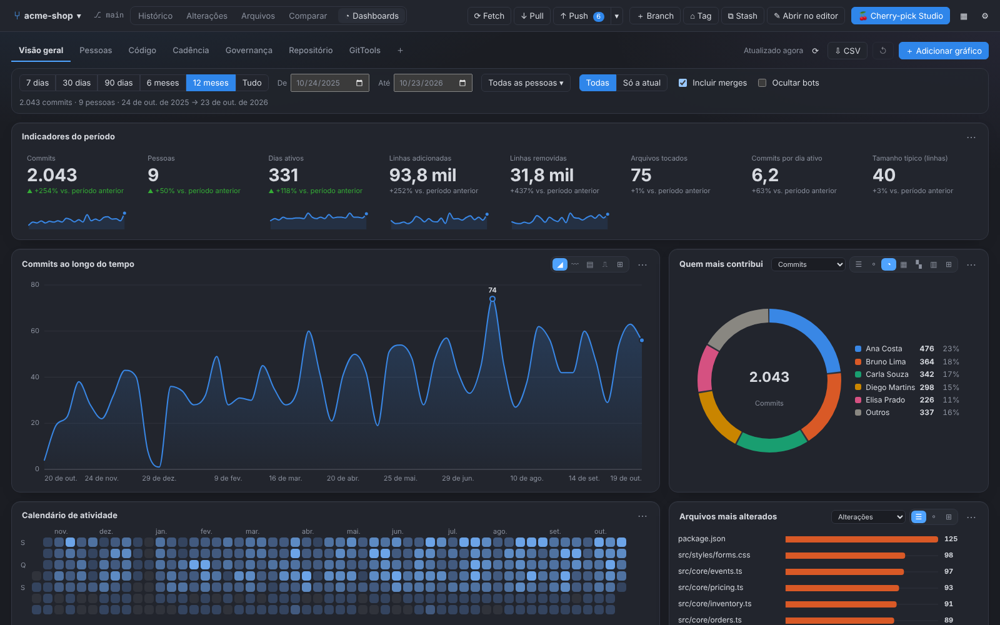

## 📊 Dashboards — o histórico do projeto em números

A aba **Dashboards** (`Ctrl+5`), no topo, ocupa a janela inteira e transforma o `git log` em painéis de gestão,
governança e auditoria — sem exportar nada, sem BI, sem sair do repositório. Cada dashboard já abre com vários
gráficos distintos e **todo gráfico muda de forma com um clique** (área, linhas, barras, rosca, treemap, mapa de calor,
radar, dispersão, funil, medidor, calendário…) ou vira tabela.

| Dashboard | O que mostra |
| --------- | ------------ |
| **Visão geral** | Indicadores com variação sobre o período anterior, commits ao longo do tempo, quem mais contribui, calendário de atividade, arquivos mais alterados, dia × hora, pastas e tipos de commit. |
| **Pessoas** | Ranking por commits, linhas, arquivos ou dias ativos; contribuição de cada pessoa no tempo, esforço, perfil (radar), novos e recorrentes, *fator de ônibus* (quanto do trabalho depende de poucas pessoas), quem mexe em quê e tabela completa. |
| **Código** | Arquivos mais alterados, mapa de pastas, linhas adicionadas/removidas, crescimento do código, tamanho dos commits, tipos de arquivo, *hotspots* de risco e arquivos que mudam juntos. |
| **Cadência** | Calendário de atividade, dia da semana × hora, commits por hora e por mês, ritmo (média móvel), sequências e pausas e a linha do tempo das releases. |
| **Governança** | Padrão de mensagens (*Conventional Commits*), horário comercial × fora dele × fim de semana, commits diretos × merges × reverts, funil de qualidade, **sinalizações de auditoria** (sem *Signed-off-by*, sem descrição, autor ≠ quem commitou, commits enormes…) e a lista de commits para revisar. |
| **Repositório** | Branches (idade, saúde, à frente/atrás do remoto), tags e releases, composição do projeto por pasta e tamanho. |
| **GitTools** | O que você fez *aqui*: saúde dos comandos git executados, os mais usados, duração, linha do tempo e os mais lentos. |

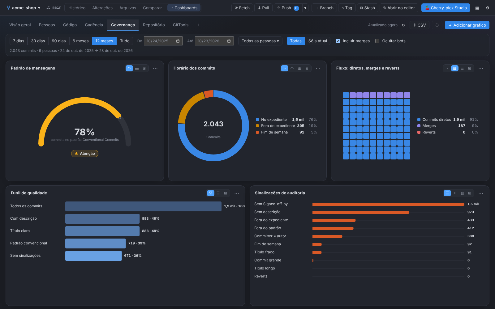

- 🎛️ **Filtros numa linha só**: período (7 dias … tudo, ou datas), pessoa, todas as branches ou só a atual, incluir merges e ocultar bots.
- ➕ **Galeria com 46 gráficos**: *Adicionar gráfico* abre o catálogo por categoria; monte **dashboards próprios**, renomeie, reordene e redimensione os cartões arrastando.
- 🧾 **Auditoria**: cada gráfico tem visão em **tabela** e *Copiar CSV* para levar os números a uma planilha ou a um relatório.
- 🌗 **Claro e escuro**, 6 idiomas, paleta acessível (cores com contraste e distinguíveis para daltônicos) e dicas ao passar o mouse em todos os gráficos.

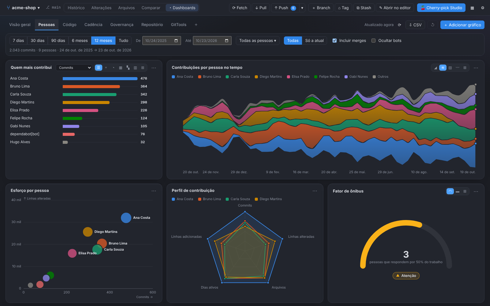
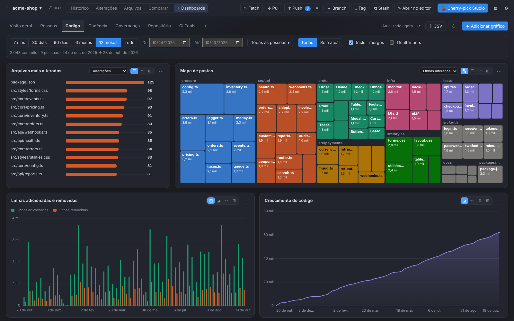
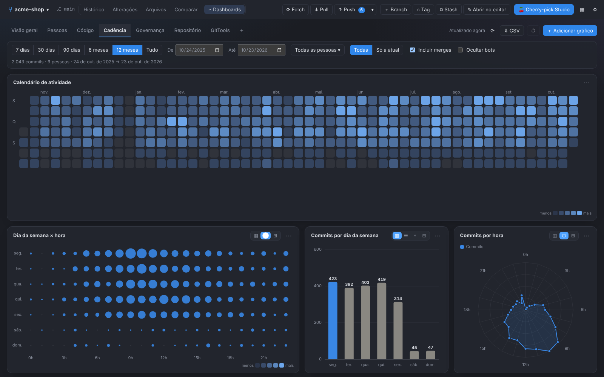
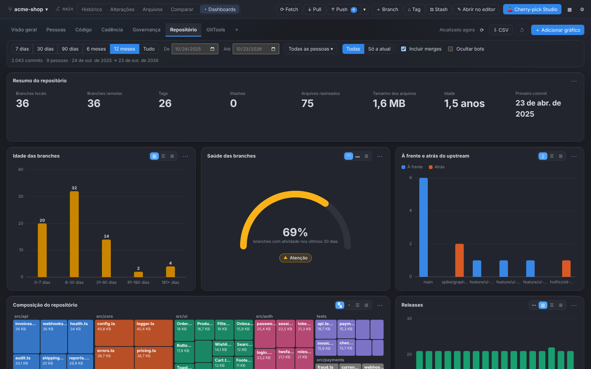
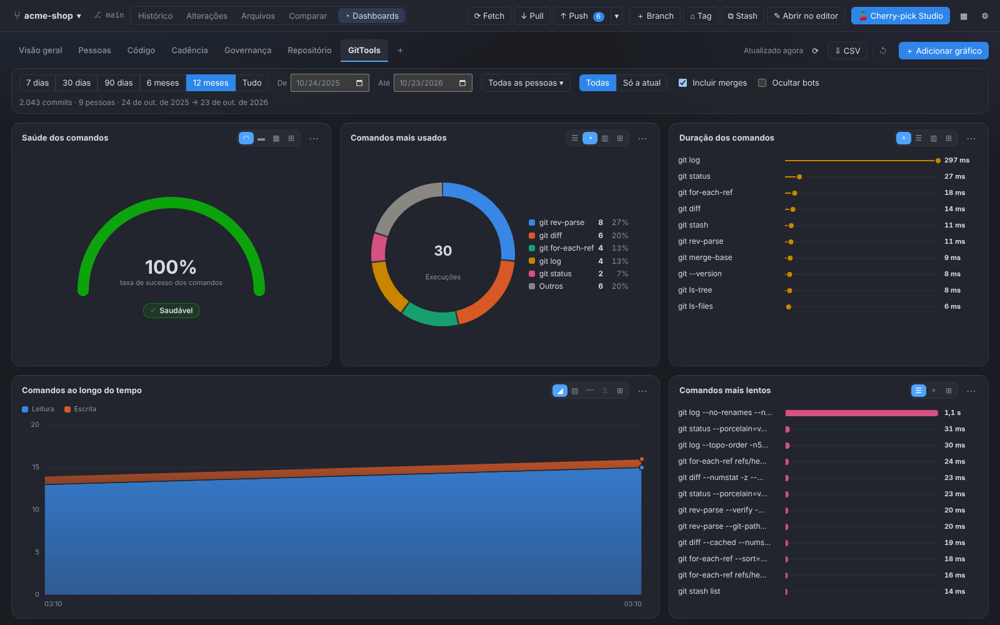
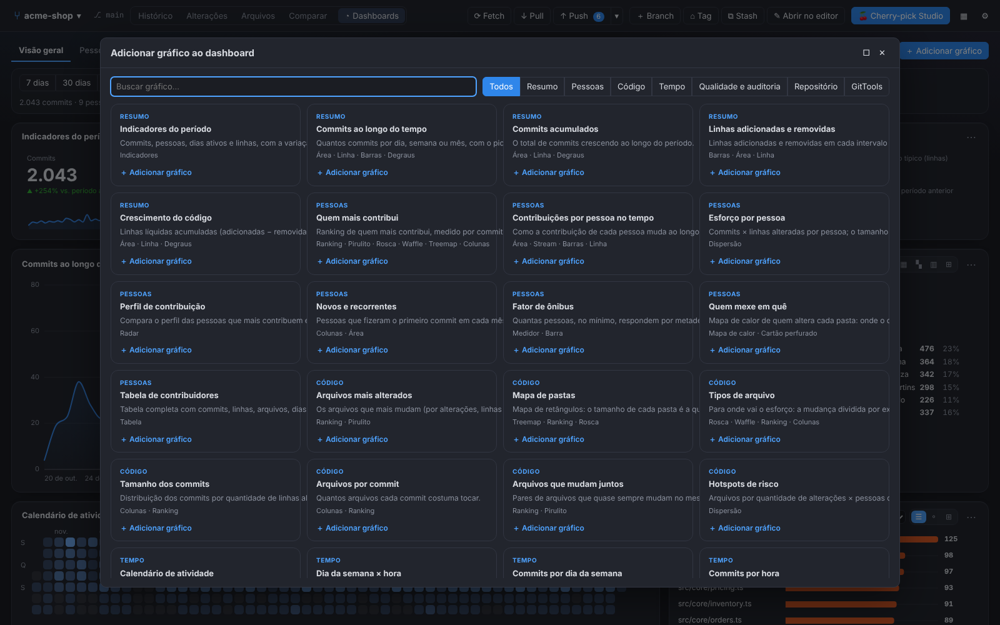
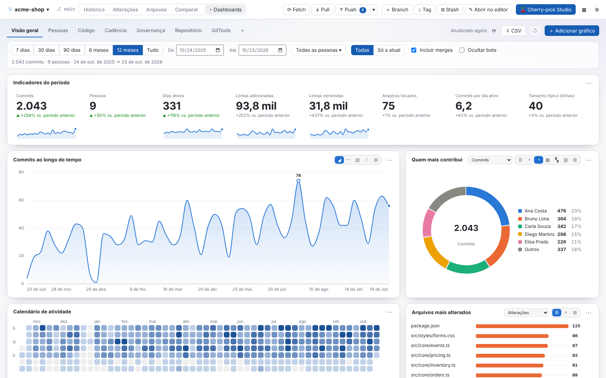

Os números vêm direto do histórico local, lidos com um único `git log --numstat` (respeita o `.mailmap`),
e nada sai do seu computador.

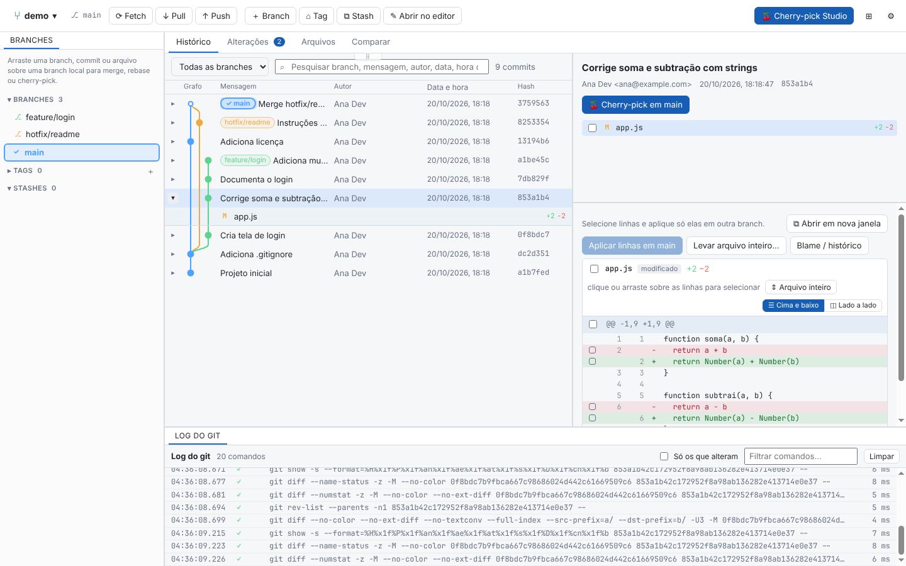

## Por que o GitTools?

> **Cansado de ter uma ferramenta para o grafo, outra para os conflitos e outra para escolher o que vai no commit?**
> O GitTools junta o melhor que as melhores ferramentas de Git do mercado têm — e entrega tudo numa interface só,
> leve, gratuita e que roda no seu computador.

- 🌳 **O grafo bonito** de um cliente visual de verdade: trilhas coloridas, pesquisa, tags e colunas que você reorganiza.
- ✅ **Escolher o commit com caixas de seleção**, ou arrastar entre *staged* e *não staged* — você decide qual visão prefere, na mesma tela.
- ✂️ **Staging linha a linha**: leve ao commit só as linhas que importam, direto do diff.
- 🔀 **Conflitos lado a lado** (atual × resultado × que entra), bloco a bloco, sem abrir o terminal.
- 🍒 **Cherry-pick de outro nível**: da branch inteira, de commits, de **arquivos** ou de **linhas**, só arrastando.
- 🧹 **Rebase interativo visual**, **blame**, histórico de arquivo e comparação de branches — tudo a um clique.
- 🧩 **A tela do seu jeito**: painéis e abas que você move para onde quiser, como num editor moderno.
- 🔒 **Sem conta, sem nuvem, sem telemetria.** Usa o Git que você já tem instalado. Código aberto (MIT).
- 🧰 **Em dois lugares**: como aplicativo próprio e como extensão dentro do **VS Code**.

*Uma ferramenta só. Todo o fluxo de Git. Sem alternar de janela.*

## O que dá para fazer

| Quero…                                        | Como fazer no GitTools                                                                                         |
| --------------------------------------------- | -------------------------------------------------------------------------------------------------------------- |
| Trazer **todos os commits** de uma branch     | Arraste a branch sobre a branch de destino → *Cherry-pick de todos os commits*. Os já aplicados são pulados.   |
| Trazer **alguns commits**                     | Selecione-os no histórico (Ctrl/Shift+clique) e arraste para a branch de destino.                              |
| Trazer **só alguns arquivos** de um commit    | Clique no commit, marque/arraste os arquivos para a branch. Escolha *aplicar as alterações* ou *copiar a versão*. |
| Trazer **só algumas linhas**                  | No diff do commit, clique/arraste sobre as linhas e clique em *Aplicar linhas em …*.                            |
| Fazer tudo isso entre duas branches de uma vez | **🍒 Cherry-pick Studio**: origem → destino, com abas *Branch inteira*, *Commits*, *Arquivos* e *Linhas*.       |
| Merge / rebase                                | Arraste uma branch sobre outra e escolha *Merge* ou *Rebase*.                                                  |
| Stage/unstage de arquivos                     | Aba *Alterações*: arraste entre “não staged” e “staged”, ou use os botões ＋ / －.                              |
| Escolher o que entra no commit **com caixas de seleção** | Aba **Alterações** → visão **Caixas de seleção**: uma lista só com todos os arquivos alterados; marque os que entram no commit (marcar = stage, desmarcar = unstage; a caixa fica parcial quando só parte do arquivo está no commit). A visão **Staged e não staged** continua ali; a escolha fica lembrada. |
| Montar a aba Alterações do seu jeito          | Arraste o cabeçalho de qualquer painel (Alterações, Staged, Commit, Diferenças…) para antes ou depois de outro, ou até a borda para abrir uma coluna nova; arraste as divisórias para redimensionar, recolha com ▾ e use o botão direito no cabeçalho para mover pelo menu. ⊞ restaura. Cada visão guarda a própria disposição; em janelas estreitas as colunas viram uma pilha. |
| Stage/unstage/descartar **linhas**            | Selecione as linhas no diff e use *Stage linhas*, *Unstage linhas* ou *Descartar linhas*.                       |
| Descartar alterações de arquivos              | Arraste-os para a lixeira (com confirmação).                                                                   |
| Resolver conflitos                            | **Resolver lado a lado**: atual × resultado × que entra, bloco a bloco (ou o arquivo todo de uma vez), na visão clássica ou em colunas, com os painéis na ordem que você quiser. Depois *Continuar*, *Pular* ou *Abortar*. |
| Ver o `git log` e o que ainda não foi commitado | A aba **Histórico** é o `git log` em forma visual (passe o mouse no selo *git log*). A **primeira linha** é sempre das alterações ainda não commitadas — com ou sem arquivos alterados: mostra quantos são (e quantos estão no stage) e, com ▸ ou um clique, abre a lista dos arquivos logo abaixo; um clique num arquivo mostra o diff no painel lateral (como nos commits), duplo clique abre numa janela, e *Abrir em Alterações* leva para a aba de commit. |
| Ler só a descrição ou só os arquivos de um commit | A **descrição**, os **arquivos** e o **diff** do commit são painéis separados: deixe à vista só os que quiser (▦ **Painéis**) e ponha lado a lado ou um sobre o outro — uma descrição enorme não esconde a lista de arquivos. O arranjo fica lembrado. |
| Saber o que aconteceu num arquivo só pelo nome | O nome do arquivo segue a cor do status em todas as listas: laranja = modificado, verde = novo/adicionado, vermelho riscado = removido, azul = renomeado. |
| Ver o tipo de cada arquivo de relance          | Ícones de arquivo por tipo e a letra da modificação (M, A, D, R…) em todas as listas; ⚙ Configurações → Aparência liga ou desliga cada um separadamente (sem a letra, a cor do nome continua mostrando o que mudou). Na extensão do VS Code a interface também segue o **tema, as fontes e as cores de status do próprio VS Code**. |
| Achar um commit                               | Campo **Pesquisar** do histórico (`Ctrl+F`): por nome de branch ou tag, mensagem, autor ou hash.                |
| Ver só a história de algumas branches         | Na barra lateral, marque as **caixas de seleção** das branches (locais ou remotas): o Histórico lista só os commits delas, o que reduz a poluição visual. ☑ no cabeçalho da seção marca/desmarca todas do grupo e *Mostrar todas* volta a listar tudo. Clicar no nome da branch continua mostrando só aquela. **A lista de branches é a referência e não muda** ao marcar várias: a faixa de filtro tem sempre a mesma altura, as cores das branches ficam as de antes e a tela não troca de painel — só o histórico e as linhas do tempo mudam. |
| Copiar a mensagem de um commit                | Botão direito no commit → **Copiar mensagem ▸** *Mensagem completa*, *Só o título* ou *Só a descrição* (com vários commits selecionados, copia as mensagens de todos). |
| Ver os arquivos de um commit sem sair da lista | ▸ ao lado do commit (ou duplo clique, ou `→`): os arquivos abrem logo abaixo da linha.                         |
| Comparar duas branches, tags ou commits       | Aba **Comparar** (ou botão direito numa branch/commit): commits exclusivos de cada lado e diff dos arquivos, com opção de trazer linhas ou a versão do arquivo. |
| Editar um arquivo sem sair do GitTools        | Aba **Arquivos** → clique no arquivo: abre no painel **Editor** (números de linha, `Tab` recua, `Ctrl+S` salva). O que você digitou fica guardado se trocar de arquivo ou de tela, e *Descartar alterações* volta ao salvo. Dê duplo clique na aba do painel (ou use ⤢) para **ampliá-lo** e ocupar a janela toda. |
| Ver quem alterou a linha em que você está     | **Assistente de git no editor**: ao final da linha do cursor aparece um balão com **quem** alterou, **quando** e **o que** o commit fez (clique para abri-lo); linhas que você acabou de escrever aparecem como *Você · editando agora*. Ligado por padrão; desligue em ⚙ Configurações → Editor e diff. |
| Saber quem mudou cada linha                   | Aba **Arquivos** → *Blame*. Clique no commit ao lado da linha para abri-lo.                                      |
| Ver o histórico de um arquivo                 | Aba **Arquivos** → *Histórico do arquivo* (segue renomeações). Restaure uma versão antiga ou traga só algumas linhas dela. |
| Reordenar, juntar, renomear ou remover commits | Botão direito num commit → **Rebase interativo**: arraste para reordenar e escolha a ação de cada commit.        |
| Outras operações                              | Checkout (duplo clique ou botão direito na branch — o primeiro item do menu), criar/renomear/excluir branch, revert, reset, stash, fetch, pull e push (botão direito / barra superior). |
| Enviar (push) normal ou com **force**         | Botão **Push** e a seta ▾ ao lado dele (ou botão direito): *Force push (com lease)* — a forma segura, recusa se o remoto tem algo novo que você não baixou — e *Force push (sobrescrever)*, ambos com confirmação. *Opções de push…* abre um diálogo com remote e modo. Também no botão direito de uma branch local (envia sem precisar de checkout) e em `Ctrl+Alt+Shift+K` (force com lease). |
| Commit, amend e push de uma vez               | Aba **Alterações**: marque *Corrigir o último commit (amend)*, *Incluir todos os arquivos* e/ou *Enviar (push) em seguida* (normal, force com lease ou force) — o botão mostra o que vai acontecer (ex.: *Corrigir e forçar push*). Se o commit corrigido já está no remoto, o force é escolhido para você. As escolhas ficam lembradas. |
| Criar uma branch com ou sem checkout          | **＋ Branch** (ou botão direito em branch/commit/tag → *Nova branch…*): a caixa *Fazer checkout da nova branch* decide se você troca para ela; a última escolha fica lembrada. |
| Organizar a lista de repositórios recentes   | Na tela inicial e no menu do repositório: **☆** move o repositório para o grupo **Favoritos** (no topo, e eles não saem da lista com o tempo) e **✕** o remove da lista — a pasta não é apagada. |
| Clonar um repositório                         | Menu do repositório (canto superior esquerdo) → **Clonar repositório…**: URL, pasta e nome; o progresso aparece no log do git. |
| Ver os comandos git que o GitTools executa    | Painel **Log do git** no rodapé, em tempo real (com filtro, “só os que alteram”, copiar comando).             |
| Nome e e-mail dos commits                     | ⚙ Configurações → **Identidade e remotes**: global (`~/.gitconfig`) ou só no repositório aberto.              |
| Adicionar outro remote (fork, espelho…)       | ⚙ Configurações → **Identidade e remotes** → *Adicionar outro remote*: nome, URL e, se quiser, já baixar o conteúdo. Também dá para trocar a URL, renomear e remover. Botão direito em **Enviar** escolhe para qual remote enviar. |
| Ver os arquivos em lista ou em árvore         | Botão **☰ Lista / ⊟ Árvore** nas listas de arquivos (histórico, detalhes do commit, Alterações, Comparar, Studio e Arquivos). A escolha vale para todas. |
| Pular de alteração em alteração num diff      | Setas ▲ ▼ no cabeçalho do diff, ou `F7` / `Shift+F7`; ◀ ▶ ou `F8` / `Shift+F8` vão para o arquivo anterior/seguinte da lista. |
| Escolher onde aparecem os avisos              | ⚙ Configurações → **Notificações**: esquerda/centro/direita, em cima/embaixo, largura e altura, com pré-visualização. |
| Guardar um layout para usar de novo          | ▦ **Painéis** → *Salvar layout atual…* dá um nome ao arranjo de agora; ▦ → *Meus layouts* o reaplica quando quiser (⚙ Configurações → Aparência também lista, aplica e exclui). Restaurar o layout padrão **não** apaga os salvos. |
| Montar a tela do seu jeito                    | Arraste as abas (Histórico, Alterações, Arquivos, Comparar, Log do git…) para outra área ou borda da janela, e os painéis pela alça ⠿ para qualquer lado. ⊞ volta tudo ao padrão. |
| Idioma, tema e atalhos                        | ⚙ **Configurações** (canto superior direito): idioma, tema claro/escuro/do sistema, tamanho da interface e atalhos de teclado personalizáveis (F1 lista todos). |

### Cherry-pick de linhas

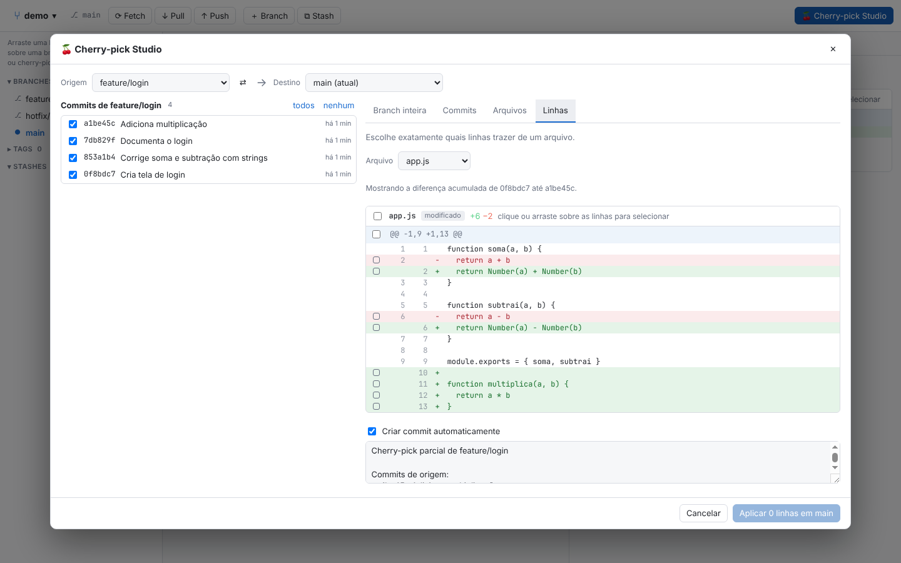

Selecione exatamente as linhas que quer levar. O GitTools monta um patch só com elas e aplica com
`git apply --3way` na branch de destino — se o contexto mudou, o Git faz a mescla de três vias e,
se mesmo assim houver conflito, ele aparece no painel de conflitos como em qualquer outra operação.

| Arrastar uma branch sobre outra | Conflito durante o cherry-pick |
| --- | --- |
| 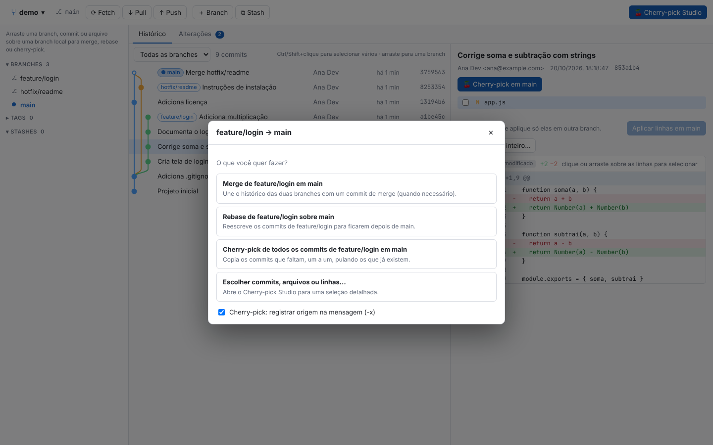 | 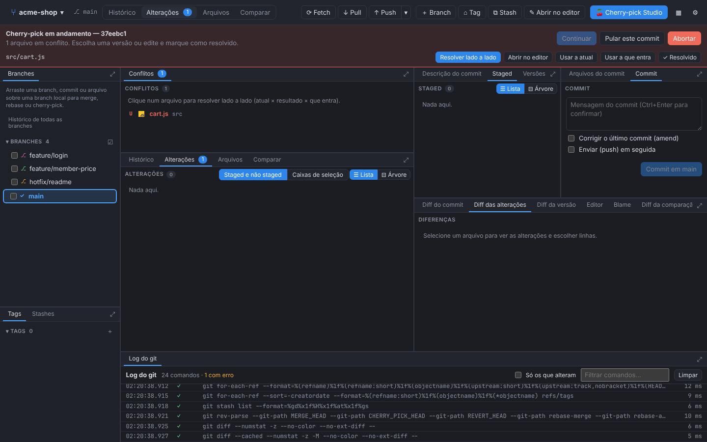 |

### Histórico


- **Cores das trilhas**: cada linha do grafo mantém a mesma cor do começo ao fim (a linha da branch
  atual não muda de cor quando outra converge nela), e as etiquetas das branches — no histórico e na
  barra lateral — usam a cor da sua trilha. A branch atual tem borda destacada e ✓.
- **Botão direito numa branch** (etiqueta no histórico ou barra lateral): o primeiro item é o checkout
  *daquela* branch. No menu de um commit, os checkouts das branches que apontam para ele vêm primeiro;
  o checkout do commit em si (HEAD destacado) fica por último entre eles.
- **Colunas**: grafo, mensagem, autor, data e hora e hash — arraste um título sobre outro para trocar
  as colunas de lugar e a borda de um título para mudar a largura (duplo clique volta ao padrão).
  Cada coluna tem seu espaço: textos longos terminam em “…” em vez de invadir a coluna vizinha. A
  coluna de data mostra também a hora.
- **Lista ou árvore**: em toda lista de arquivos o botão **☰ Lista / ⊟ Árvore** alterna entre uma
  linha por arquivo — **nome em destaque e, ao lado, a pasta** (`Button.tsx  src/app/ui`; renomeações
  mostram `← caminho antigo`) — e uma árvore de pastas recolhíveis (pastas com um só filho são
  juntadas: `src/app/ui`). A escolha vale para o histórico, os detalhes, Alterações,
  Comparar, Studio e Arquivos.

  | Lista (nome + pasta) | Árvore |
  | --- | --- |
  | 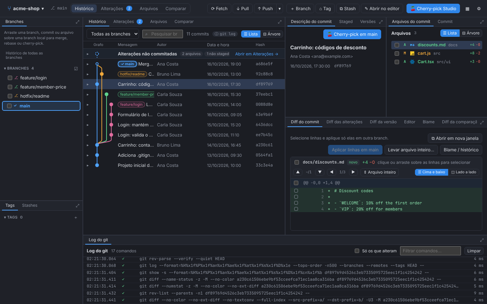 | 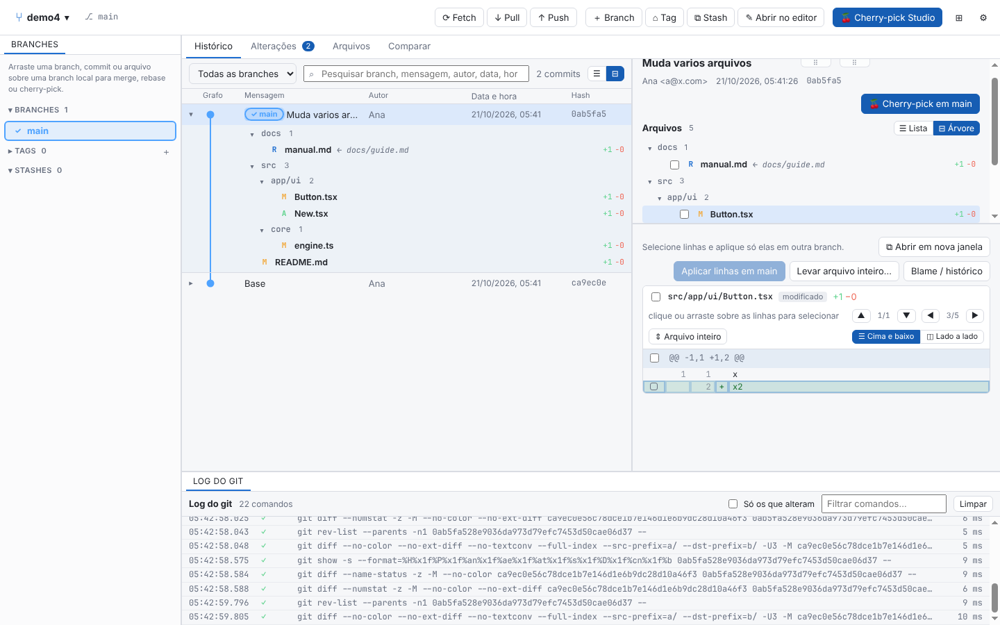 |
- **Navegação nos diffs**: ▲ ▼ no cabeçalho do diff (com `3/7` mostrando onde você está) e `F7` /
  `Shift+F7` pulam para a alteração seguinte/anterior, destacando-a; ◀ ▶ e `F8` / `Shift+F8` vão
  para o arquivo anterior/seguinte da lista ao lado. Funcionam também na janela própria de diff e no
  Studio; as teclas podem ser trocadas em Configurações → Atalhos de teclado.
- **Linhas adicionadas e removidas** (`+12 −3`) ao lado de cada arquivo: nos arquivos abertos no
  próprio histórico, nos detalhes do commit, em Alterações, Comparar, Arquivos e no Studio.
- **Pesquisa** (`Ctrl+F`): filtra por branch, tag, mensagem, autor, data ou hora (ex.: `21/10/2026`,
  `2026-10-21`, `14:30`) ou início do hash; Enter vai para o primeiro resultado e Esc limpa.
- **Arquivos do commit na própria lista**: ▸ (ou duplo clique, ou `→`/`←`) abre e fecha os arquivos
  logo abaixo da linha do commit. Clique num arquivo para ver o diff; **duplo clique** abre só o diff
  daquele arquivo numa janela própria; arraste-o para uma branch.
- **Diff em nova janela**: ⧉ *Abrir em nova janela* (ou duplo clique / botão direito no arquivo)
  abre o diff numa janela do sistema, que pode ir para outro monitor; ela se atualiza quando volta a
  ter o foco. Vale para os detalhes do commit, Alterações, Comparar e o histórico de um arquivo.
- **Trecho alterado ou arquivo inteiro**: ⚙ Configurações → Editor e diff → *Conteúdo do diff* escolhe se
  todo diff abre só com os trechos alterados ou com o arquivo completo e as alterações destacadas. O botão
  ⇕ *Arquivo inteiro* no cabeçalho de qualquer diff troca na hora (vale para todos os diffs e fica
  lembrado até você mudar o padrão nas configurações).
- **Ver o diff com o painel escondido**: escolher um arquivo (clique ou botão direito → *Ver diff*) traz o
  painel do diff à frente se ele estava escondido ou atrás de outra aba.
- **Tags**: crie uma tag no commit atual (botão *Tag* na barra), em qualquer commit ou branch (botão
  direito) ou pelo ＋ da seção Tags; com mensagem, a tag é anotada.
- **Diff "cima e baixo" ou "lado a lado"**: todo diff abre no modo escolhido em ⚙ Configurações →
  Editor e diff; os botões no cabeçalho trocam o modo do diff aberto. A seleção de linhas funciona nos
  dois modos.
- **Abrir no editor**: o arquivo é sempre aberto pelo **caminho completo** (inclusive no Windows,
  onde o git informa a pasta com `/`), e o botão **Testar** abre um arquivo do repositório pelo mesmo
  caminho. Um arquivo que só existe em outro commit avisa em vez de falhar em silêncio. Escolha em ⚙ Configurações → Editor e diff um dos editores encontrados no
  computador, o executável de qualquer outro ou
  digite o comando (ex.: `meu-editor --reuse-window`, `/Applications/MeuEditor.app`). O botão **Testar** abre o
  projeto e mostra o erro se o editor não iniciar. O botão *Abrir no editor* da barra abre o projeto
  inteiro nele. Na **extensão do VS Code** não há editor a escolher: os arquivos abrem no próprio editor
  do VS Code, ao lado do painel do GitTools.

### Log do git

O painel **Log do git** (no rodapé) mostra em tempo real cada comando
git que o GitTools executa enquanto você usa a interface: hora, resultado (✓ / ✕ com o código de
saída e a primeira linha do erro), comando completo e duração. Filtre pelo texto, marque *Só os que
alteram* para esconder as leituras que a interface faz para se atualizar, copie um comando (duplo
clique ou botão direito) e limpe a lista. Como qualquer aba, ele pode ser arrastado para outra área.

### Filtrar o histórico por branches

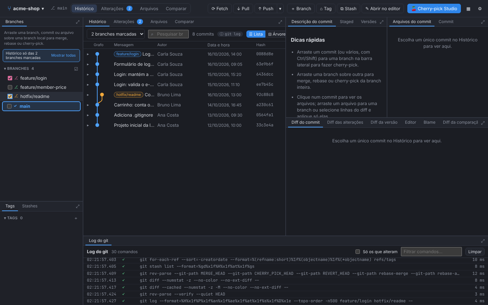

Marque as caixas das branches que interessam: o histórico (e as linhas do tempo) passa a mostrar só a história
delas, enquanto a lista de branches fica exatamente como estava — mesma altura, mesmas cores, mesmo painel à
frente. *Mostrar todas* (na faixa de filtro, que tem sempre o mesmo tamanho) volta a listar tudo.

### Vários repositórios abertos ao mesmo tempo

Cada repositório aberto ganha uma **aba** com a cor dele (sempre a mesma para o mesmo caminho). A faixa no topo
da janela e o nome na barra de ferramentas mostram de qual repositório é a tela. Abrir outro repositório (menu
*Repositório* ou **＋**) cria uma nova aba; clique do meio ou **×** tiram a aba da sessão (nada é apagado, e
quem tem alterações não commitadas ou operação em andamento é avisado antes).

Para não misturar repositórios:

- ao trocar de aba, a tela é montada de novo: seleção, diff, filtros e rascunhos não passam de um para o outro;
- antes de trocar, as operações em andamento do repositório que sai terminam (com botão para trocar mesmo assim);
- os diálogos de confirmação mostram o nome do repositório, e os avisos o citam quando há mais de um aberto;
- o log de comandos diz de qual repositório é cada comando.

Para trazer commits de um repositório para outro, arraste-os para a aba do destino ou use o menu de contexto
*Aplicar em outro repositório aberto*. Antes de aplicar, o GitTools mostra origem e destino (com a branch atual
do destino) e só então faz o cherry-pick. **Ctrl+Tab** / **Ctrl+Shift+Tab** alternam as abas e **Ctrl+W** fecha a aba atual.

### Clonar e identidade git

| Clonar repositório | Identidade e remotes |
| --- | --- |
| 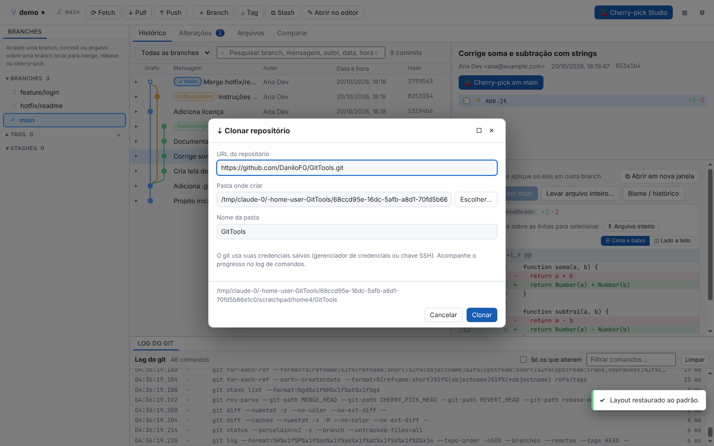 | 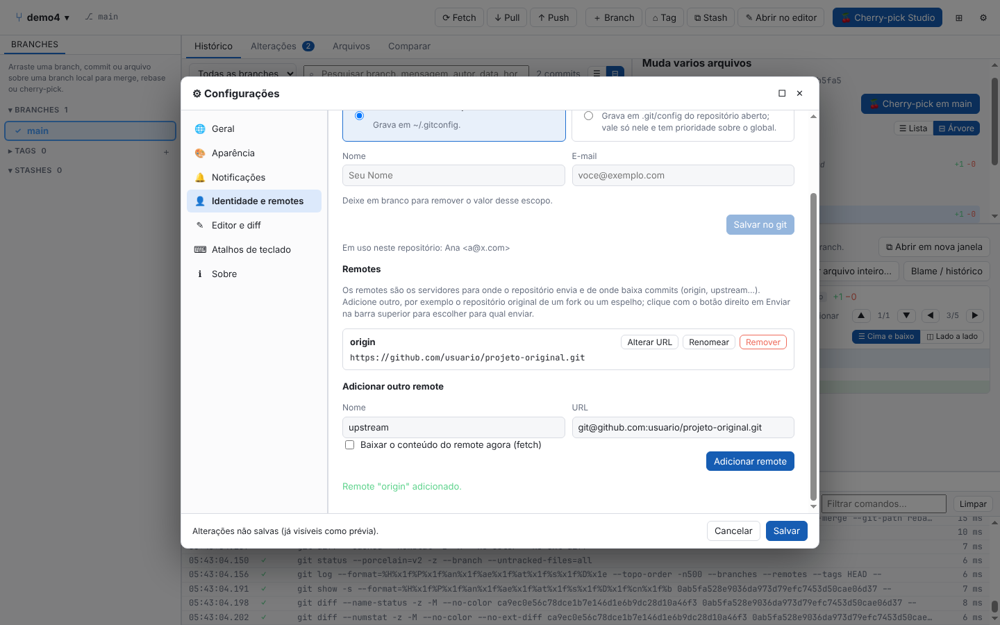 |

- **Clonar**: menu do repositório → *Clonar repositório…* (também na tela inicial). Informe a URL
  (HTTPS ou SSH — usa as credenciais já salvas no git), a pasta e o nome; ao terminar, o repositório
  clonado é aberto.
- **Identidade e remotes**: ⚙ Configurações → *Identidade e remotes* define `user.name` e `user.email` para
  **todos os repositórios** (global) ou **só o repositório aberto** (local, que tem prioridade).
  Deixe em branco para remover o valor daquele escopo; abaixo aparece a identidade em uso.
  Logo abaixo ficam os **remotes** do repositório: veja as URLs, **adicione outro remote** (nome + URL,
  com a opção de já baixar o conteúdo), altere a URL, renomeie ou remova. Com mais de um remote,
  clique com o botão direito em **Enviar** (barra superior) para escolher para qual enviar.

### Notificações

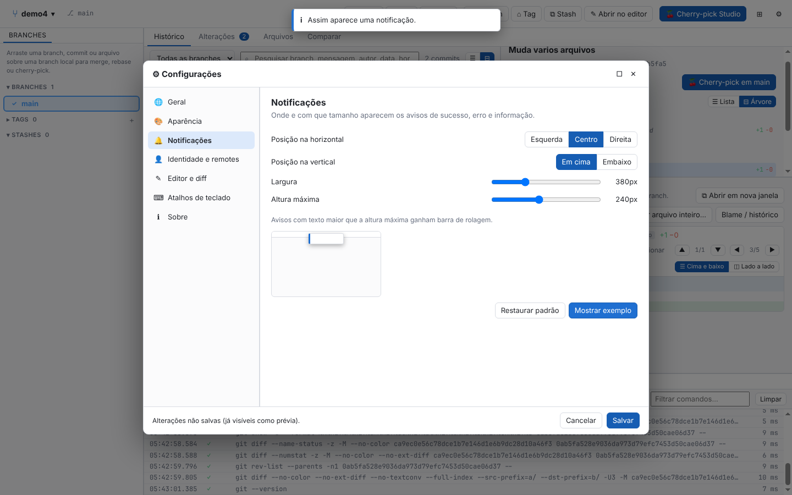

⚙ Configurações → **Notificações** escolhe onde aparecem os avisos de sucesso, erro e informação:
posição na horizontal (esquerda, centro, direita) e na vertical (em cima, embaixo), **largura** e
**altura máxima** (textos maiores ganham barra de rolagem). A mudança aparece na hora, e *Mostrar
exemplo* dispara um aviso de teste.

### Editor de conflitos

| Colunas | Clássica (versões em cima, resultado embaixo) |
| --- | --- |
| 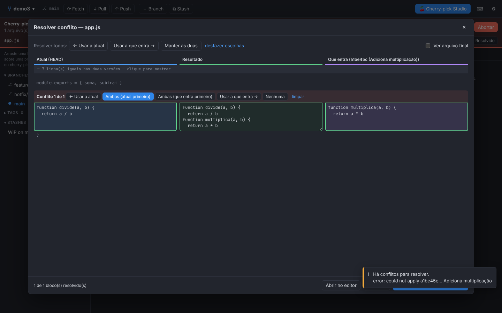 | 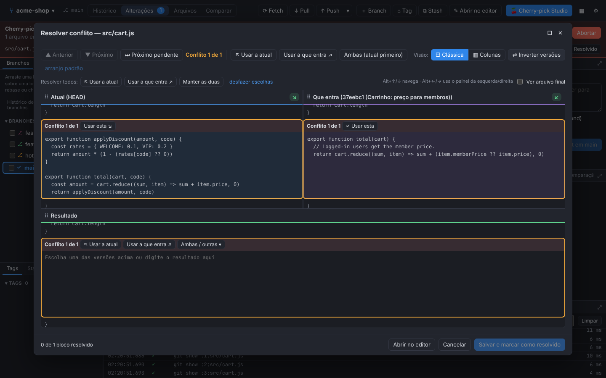 |

Três painéis — **Atual (HEAD)**, **Resultado** e **Que entra** — que rolam juntos e mostram cada bloco em
conflito na mesma altura. Escolha a visão em *Visão*: **Clássica** (as duas versões lado a lado em cima e
o resultado embaixo) ou **Colunas**. **Arraste o cabeçalho de um painel sobre outro** para trocá-los de
lugar (ou use o botão direito no cabeçalho, ou *Inverter versões*); o GitTools lembra do arranjo.

As setas acompanham a posição real dos painéis: o "Usar esta →" de cada versão aponta para onde está o
resultado, e "Usar a atual"/"Usar a que entra" apontam para onde está cada versão — em qualquer arranjo,
inclusive em idiomas escritos da direita para a esquerda. A navegação segue sempre a ordem do arquivo:

| Teclas | Ação |
| --- | --- |
| `Alt+↓` / `Alt+↑` | Próximo / anterior conflito |
| `Alt+Shift+↓` | Próximo conflito ainda não resolvido |
| `Alt+←` / `Alt+→` | Usar a versão do painel da **esquerda** / **direita** no conflito atual e ir ao próximo pendente |

Para cada bloco: *Usar a atual*, *Usar a que entra* e, no menu *Ambas / outras*, *Ambas* (em qualquer
ordem), *Original* (versão do ancestral comum) ou *Nenhuma* — e o resultado pode ser editado à mão.
Arquivos binários ou removidos de um dos lados oferecem a escolha da versão inteira.

### Comparar, blame e histórico de arquivo

| Comparar duas referências | Blame por linha | Histórico do arquivo |
| --- | --- | --- |
| 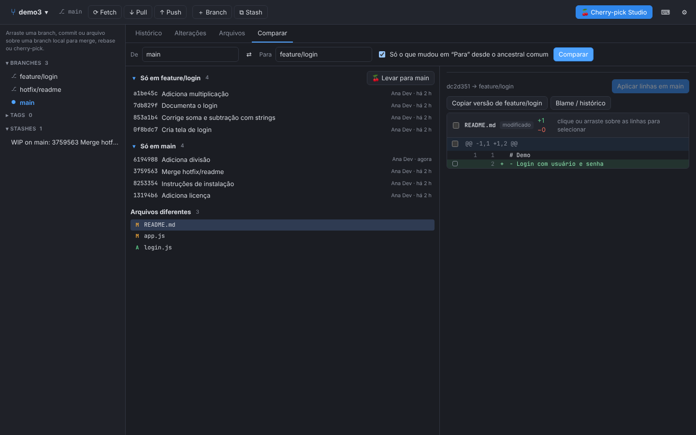 | 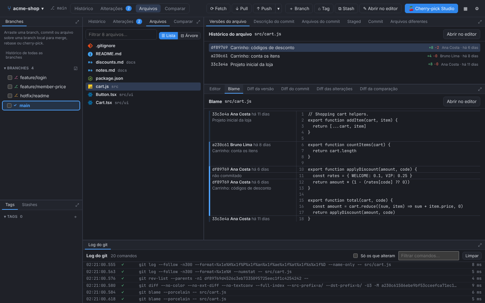 | 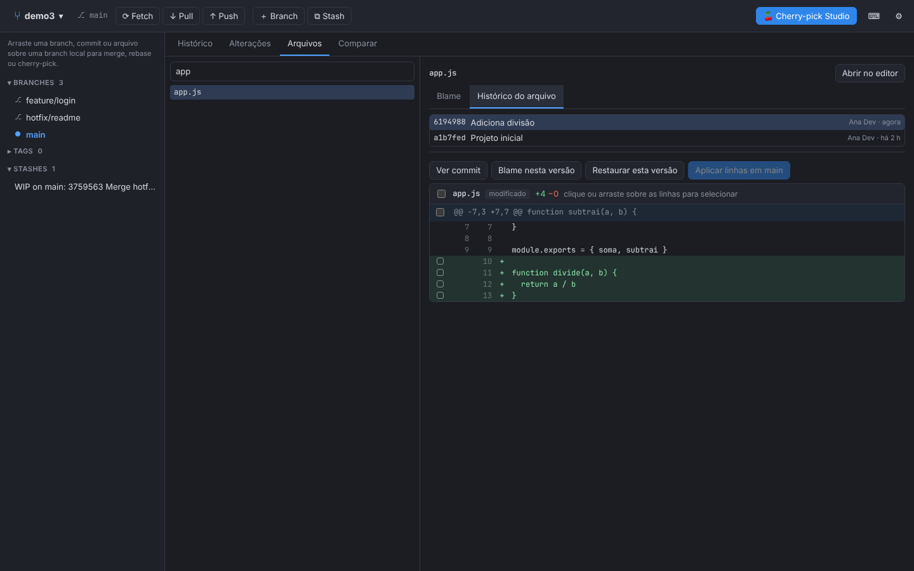 |

### Editor de arquivos com assistente de git

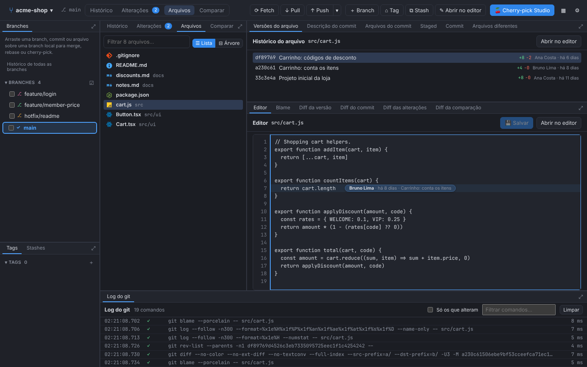

Clique num arquivo da aba **Arquivos** para editá-lo ali mesmo: números de linha, linha atual realçada, recuo
automático no `Enter`, `Tab` / `Shift+Tab` para recuar (usa o recuo que o arquivo já tem), `Ctrl+S` para salvar e
*Descartar alterações* para voltar ao conteúdo salvo. As quebras de linha (LF / CRLF) e o BOM do arquivo são
preservados, e o que você digitou não se perde ao trocar de arquivo ou de tela (a lista marca com ● os arquivos
com alterações não salvas). Se o arquivo mudar no disco enquanto você edita, o editor avisa antes de sobrescrever.
Arquivos binários ou maiores que 2 MB continuam abrindo no seu editor (*Abrir no editor*).

**Assistente de git inline**: o balão ao final da linha do cursor mostra *quem* alterou a linha, *quando* e *o
que* o commit fez; clique nele para abrir o commit. Linhas que você acabou de escrever mostram *Você · editando
agora*, e as já salvas mas ainda não commitadas, *Você · salvo, ainda não commitado*. Vem ligado — desligue em
⚙ Configurações → **Editor e diff** → *Assistente de git no editor*.

### Rebase interativo visual

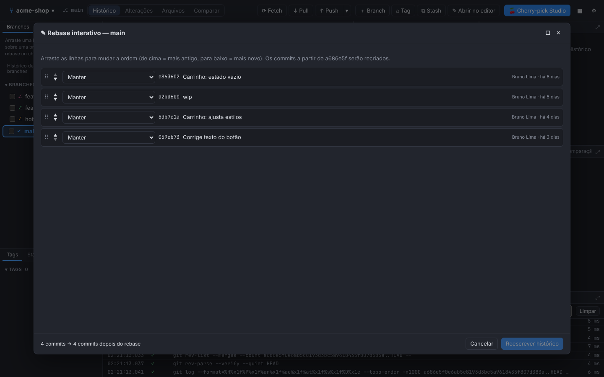

Arraste (ou use ▲▼) para reordenar e escolha para cada commit: *Manter*, *Editar mensagem*, *Juntar ao
anterior* (squash, com mensagem combinada ou nova), *Juntar descartando a mensagem* (fixup) ou *Remover*.
Alterações locais são guardadas e devolvidas automaticamente (`--autostash`); conflitos aparecem no
mesmo painel das outras operações.

### Idiomas

A interface inteira — inclusive as mensagens de erro e de resultado das operações git — está disponível em:

| Idioma | Código |
| --- | --- |
| Português (Brasil) | `pt-BR` |
| English | `en` |
| 简体中文 (chinês simplificado) | `zh-CN` |
| हिन्दी (hindi) | `hi` |
| Español | `es` |
| العربية (árabe, escrito da direita para a esquerda) | `ar` |

Por padrão o GitTools segue o idioma do sistema operacional; troque em ⚙ Configurações → Geral.
A mudança é aplicada na hora, como prévia, e só é gravada ao clicar em *Salvar*.

| Árabe (layout espelhado) | Chinês |
| --- | --- |
| 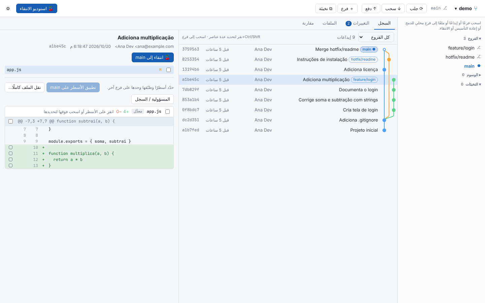 | 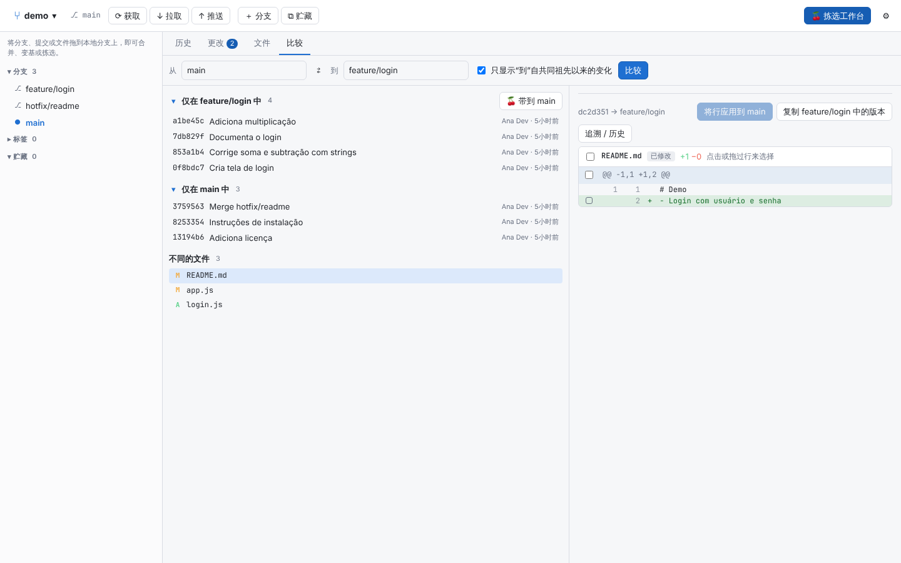 |

### Layout livre

Nenhuma tela é "pai" ou "filha" de outra: **cada painel é independente** e pode ficar em qualquer lugar da
janela, junto de qualquer outro. A lista de commits, a descrição, os arquivos e o diff do commit, as listas
*Não staged* e *Staged* (ou a lista com caixas de seleção), a caixa de commit, o diff das alterações, os
arquivos, o blame, as versões de um arquivo, a comparação e o log do git são painéis separados.

**Organização por menus:** a barra logo abaixo da ferramenta tem um menu por área (Histórico, Alterações,
Arquivos, Comparar, Branches e Log do git), e cada um mostra só os painéis dele, sem os de outras áreas.
Um painel de outra área aparece num menu só se você o fixou ali (▦ Painéis → *Painéis de outras telas*); o
menu indica quantos estão fixados (ex.: *+2*). Ações que levam a outra área (como *Mostrar alterações* de um
conflito) abrem o menu certo. Layouts salvos antes dessa organização mantêm posições e painéis escondidos.

| Soltar no meio de outro painel: vira aba dele | Soltar junto de uma borda: divide o painel nesse lado |
| --- | --- |
| 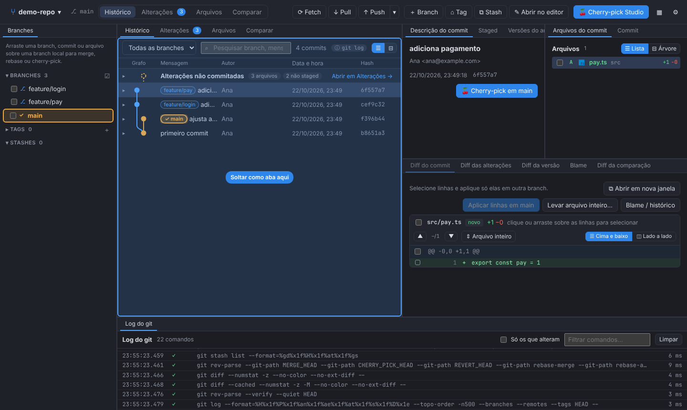 | 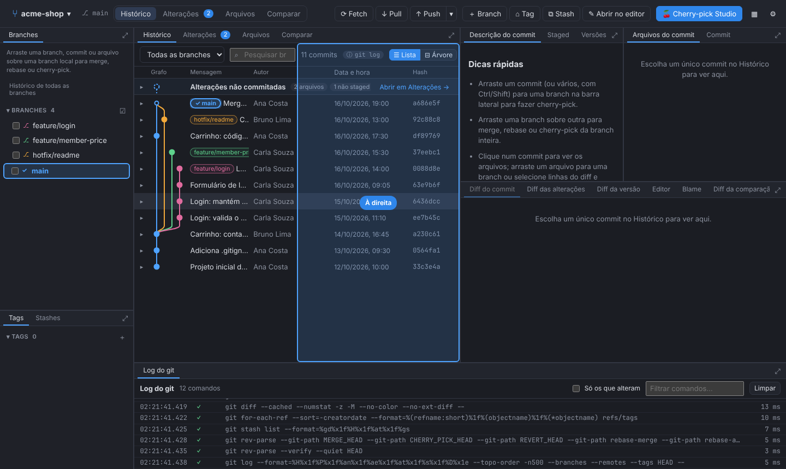 |

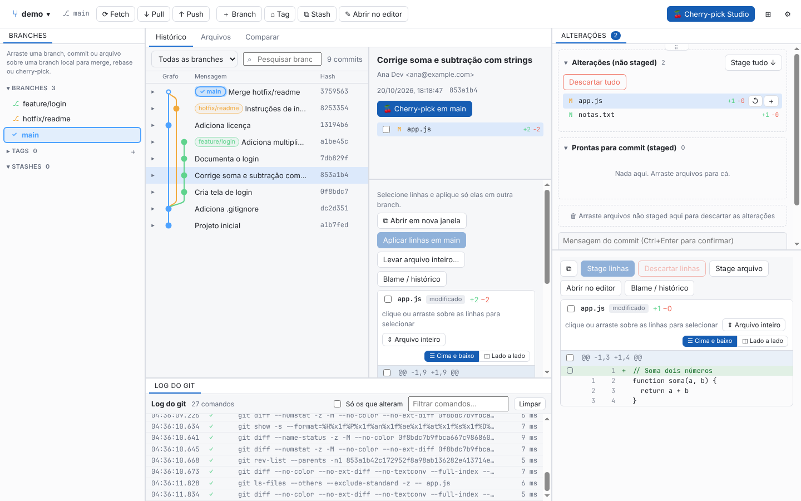

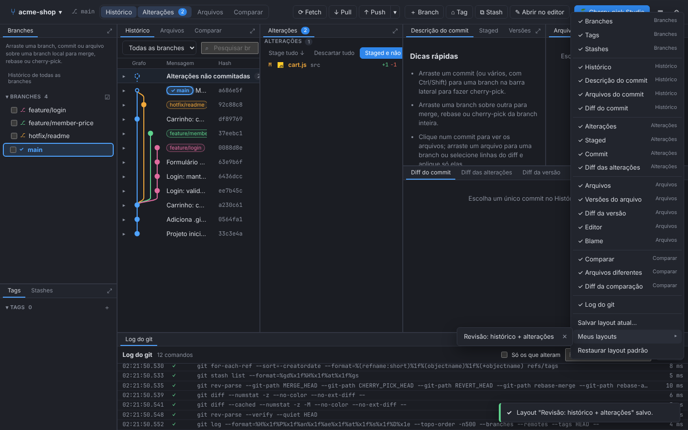

- **Qualquer painel em qualquer lugar**: arraste a aba de um painel e solte no *meio* de outro painel (ela
  vira uma aba dele), *junto de uma borda* dele (o painel é dividido e o seu fica nesse lado — esquerda,
  direita, em cima ou embaixo) ou na *borda da janela* (ocupa toda a altura ou a largura). Um destaque
  mostra onde ela vai ficar; soltar entre as abas de um painel só as reordena. Quando um painel fica sem
  abas ele some e os vizinhos ocupam o espaço.
- **Telas**: os menus da barra de menus (e `Ctrl+1` … `Ctrl+4`) mostram só os painéis de cada tela. Clicar
  num arquivo ou commit mostra o painel do diff dentro do menu em que você está, mesmo que ele estivesse
  escondido ou atrás de outra aba.
- **Botão direito numa aba**: *Separar para o lado* (esquerda, direita, em cima, embaixo), *Encaixar na
  borda da janela*, *Ocultar este painel* e *Restaurar layout padrão* — os mesmos movimentos do arrastar,
  para quem prefere o menu.
- **▦ Painéis** (barra de menus, à direita): mostra ou esconde os painéis do menu aberto, um a um, e fixa
  painéis de outros menus nele. `Ctrl+B` mostra/oculta a barra de Branches no menu aberto. Os painéis
  escondidos voltam para o lugar onde estavam.
- **Divisórias**: arraste para redimensionar; duplo clique (ou `Enter`) deixa os dois lados iguais; com o
  foco na divisória, as setas ajustam o tamanho. Em janelas pequenas os painéis encolhem juntos.
- **Restaurar layout**: ▦ Painéis → *Restaurar layout padrão* (ou ⚙ Configurações → Aparência), com
  confirmação. O GitTools **lembra** do arranjo escolhido.
- **Layouts salvos**: monte o arranjo que você gosta e use ▦ Painéis → *Salvar layout atual…* para dar um
  nome a ele; ▦ → *Meus layouts* reaplica qualquer um (o ✕ ao lado exclui), e ⚙ Configurações → Aparência
  também lista, aplica e exclui. Salvar com um nome que já existe substitui o antigo (com confirmação).
  O layout guarda posição, abas e tamanhos dos painéis; restaurar o padrão não apaga os layouts salvos.
- **Ampliar um painel**: o botão ⤢ no fim da barra de abas (ou duplo clique numa aba) faz aquele painel
  ocupar a janela toda — ótimo para o editor ou o blame; ⤡ volta ao arranjo de antes.
- **Ações no lado direito**: os botões de cada componente (cabeçalho do diff, detalhes do commit, grupos de
  Alterações, avisos de operação…) ficam sempre no fim — o lado direito — do próprio componente; em
  árabe e outros idiomas da direita para a esquerda tudo é espelhado (inclusive os lados do arrastar).
- **Seções reordenáveis**: arraste as seções da barra lateral para mudar a ordem.
- **Janelas móveis e redimensionáveis**: diálogos (Studio, editor de conflitos, rebase, configurações…)
  se movem pelo título (⌖ volta ao centro), se redimensionam pelas bordas e maximizam pelo botão □ ou com
  duplo clique no título. Dentro deles, as divisórias também são arrastáveis (duplo clique volta ao padrão)
  e os botões ◂ ▸ recolhem um dos lados.
- **Painéis ajustáveis** no editor de conflitos (atual × resultado × que entra, em colunas ou na visão
  clássica) e coluna do blame ajustável.

### Configurações

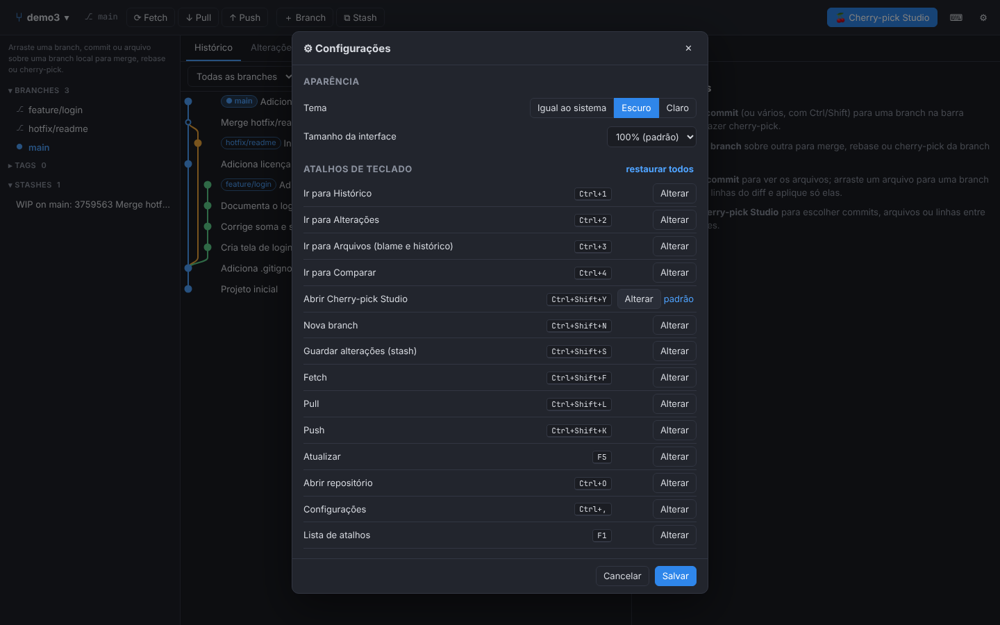

Todas as opções gerais ficam num único lugar, separadas em seções: **Geral** (idioma),
**Notificações** (posição e tamanho dos avisos), **Identidade e remotes** (nome e e-mail dos commits, remotes do repositório), **Editor e diff** (editor
para abrir arquivos, com teste, **assistente de git no editor** — ligado por padrão —, conteúdo do diff — trecho alterado ou arquivo inteiro — e modo do diff),
**Aparência** (tema, ícones de arquivo, letras das modificações M/A/D, tamanho, espessura das divisórias, tamanho dos botões de recolher/expandir e
restaurar ou **salvar o layout** dos painéis), **Atalhos de teclado** (com pesquisa pelo nome da ação ou pelas
próprias teclas: clique em *Gravar teclas* e pressione a combinação) e **Sobre** (versões do GitTools, do git e
do sistema, local do arquivo de configurações e "Restaurar padrões").

### Atalhos de teclado

| Ação | Padrão |
| --- | --- |
| Histórico / Alterações / Arquivos / Comparar / Dashboards | `Ctrl+1` … `Ctrl+5` |
| Mostrar/ocultar a barra lateral | `Ctrl+B` |
| Pesquisar no histórico | `Ctrl+F` |
| Próxima / anterior aba de repositório; fechar a aba | `Ctrl+Tab` / `Ctrl+Shift+Tab`; `Ctrl+W` |
| Cherry-pick Studio | `Ctrl+Shift+P` |
| Nova branch / Stash | `Ctrl+Shift+N` / `Ctrl+Shift+S` |
| Fetch / Pull / Push | `Ctrl+Shift+F` / `Ctrl+Shift+L` / `Ctrl+Shift+K` |
| Push com force (lease) | `Ctrl+Alt+Shift+K` |
| Atualizar / Abrir repositório | `F5` / `Ctrl+O` |
| Configurações / Lista de atalhos | `Ctrl+,` / `F1` |
| Mover / estender a seleção no histórico | `↑` `↓` / `Shift+↑` `Shift+↓` |
| Abrir / fechar os arquivos do commit no histórico | `→` / `←` |
| Diff: próxima / anterior alteração | `F7` / `Shift+F7` |
| Diff: próximo / anterior arquivo da lista | `F8` / `Shift+F8` |
| Editor de conflitos: navegar / usar o painel da esquerda ou direita | `Alt+↑` `Alt+↓` / `Alt+←` `Alt+→` |

No macOS, `Ctrl` corresponde a `⌘`. Todos podem ser trocados em ⚙ Configurações.

**Copiar texto**: selecione com o mouse e use `Ctrl+C`, ou o botão direito (*Copiar linha*, *Copiar caminho*, *Copiar SHA*…). Num diff, as colunas de números e sinais não entram na cópia. Em linhas que se arrastam (commits, branches, arquivos), **segure `Alt`** enquanto arrasta para selecionar o texto.

## Extensão do VS Code

O GitTools também roda **dentro do VS Code**: a mesma interface (histórico com grafo, Cherry-pick Studio,
conflitos lado a lado, rebase interativo, remotes…) num painel, com o git da sua máquina. Veja
[`extension/README.md`](extension/README.md).

- **Abrir**: `Ctrl+Alt+G` (`⌘⌥G` no macOS), o botão **⑂ GitTools** na barra de status ou o ícone no título
  do *Controle do código-fonte*. A pasta aberta no VS Code é usada se for um repositório; também há
  **GitTools: Abrir um repositório…**, **Abrir esta pasta no GitTools** (menu do Explorer) e
  **Ver as alterações deste arquivo no GitTools** (título do editor).
- Os arquivos que o GitTools abre vão para o **editor do próprio VS Code**, ao lado do painel; o tema
  segue o do VS Code; o diff em nova janela abre outro painel.
- **Gerar o `.vsix`**: `npm run package:extension` cria `release/gittools-vscode-<versão>.vsix` (instale
  com `code --install-extension release/gittools-vscode-*.vsix`). `npm run build:extension` só compila.
- **Publicar uma versão** (automático): o workflow `publish-extension.yml` testa, empacota e publica no
  VS Code Marketplace; os usuários recebem a atualização sozinhos. Ele roda **a cada merge na `main` que
  mexa no que vai para a extensão** (`extension/`, `src/` exceto `main` e `preload`, `scripts/` e os
  arquivos de build) usando a versão de `extension/package.json` — **suba a versão na PR** para publicar;
  se ela já estiver publicada, o workflow termina sem fazer nada. Também roda ao criar uma tag
  (`git tag v0.5.1 && git push origin v0.5.1`, com a versão da tag) e manualmente em *Actions → Run
  workflow*. Cada publicação nova cria o release `v<versão>` com o `.vsix` anexado. Configuração única:
  em *Settings → Secrets and variables → Actions* crie o secret `VSCE_PAT` (token do Marketplace, escopo
  *Marketplace → Manage*); o secret opcional `OVSX_PAT` publica também no Open VSX.
  Sem o secret o workflow só anexa o `.vsix` ao release do GitHub.
- **Como é feito**: a lógica do aplicativo (repositório aberto, configurações, log de comandos,
  remotes, clone…) ficou num `Backend` em `src/backend`, que o Electron e a extensão usam; cada um só
  fornece o `BackendHost` (diálogos, abrir arquivos, janelas). No webview, `src/renderer/src/vscodeBridge.ts`
  faz o papel do preload, trocando mensagens com a extensão (`extension/src/extension.ts`). Os testes usam
  uma versão mínima da API do VS Code (`tests/support/vscode.ts`).

## Como rodar

Pré-requisitos: [Node.js](https://nodejs.org/) 20+ e [Git](https://git-scm.com/) 2.23+ no `PATH`.

```bash
npm install
npm run dev            # abre o app em modo desenvolvimento
npm run dev -- -- /caminho/do/repositorio   # já abrindo um repositório
```

Outros comandos:

```bash
npm test               # testes do motor git (cria repositórios temporários reais)
npm run typecheck      # verificação de tipos
npm run build          # gera out/
npm run dist           # gera o instalador para o seu sistema em release/
npm run dist:win       # (ou dist:mac / dist:linux)
```

Os prints (`docs/screenshots`) e os GIFs da extensão (`extension/media/readme`) são gerados a partir da
interface real, com repositórios de exemplo criados na hora — `scripts/readme-media/`:

```bash
npm run build:extension                      # a interface empacotada que o roteiro abre
node scripts/readme-media/capture.mjs local  # prints do README (pt-BR); `extension` gera os da extensão (en)
node scripts/readme-media/gifs.mjs           # GIFs da extensão (precisa do ffmpeg)
node scripts/readme-media/dashboards.mjs local      # prints dos Dashboards (pt-BR) num repositório de exemplo grande; `extension` (en) e `gif` também
```

Precisam do [Playwright](https://playwright.dev/) instalado (`PLAYWRIGHT_MODULE` e `CHROMIUM` indicam onde,
se não estiverem nos caminhos padrão); passe o nome de um print para refazer só ele.

## Como funciona

```
src/
├── core/               Motor git (Node puro, sem Electron) — testado em tests/
│   ├── exec.ts         Executa o git sem shell e sem prompts interativos (e avisa cada comando ao log)
│   ├── config.ts       Identidade git (user.name/user.email) e git clone
│   ├── paths.ts        Caminho relativo → absoluto dentro do repositório (raiz do git no Windows)
│   ├── diff.ts         Lê diffs unificados e monta patches parciais (linhas escolhidas)
│   └── repository.ts   Status, branches, log, stage, merge, rebase (inclusive interativo), cherry-pick
│                       (branch/commits/arquivos/linhas), conflitos, comparação, blame, histórico, stash, remotos
├── backend/            Lógica comum ao aplicativo e à extensão (repositório aberto, configurações, log, clone…)
├── main/               Processo principal do Electron: janela, diálogos, IPC
├── preload/            Ponte segura (contextIsolation) exposta como window.gittools
├── shared/             Tipos, contrato da API, marcadores de conflito, configurações e idiomas
│   ├── settings.ts     Formato, valores padrão e validação das configurações
│   └── i18n/           Traduções (usadas pelo motor git, pelo processo principal e pela interface)
│       ├── locales.ts  Lista de idiomas e detecção do idioma do sistema
│       ├── translator.ts  Parâmetros {nome} e plurais (Intl.PluralRules)
│       └── messages/   Um arquivo por idioma; pt-BR.ts é a referência
└── renderer/           Interface em React
    ├── src/fileTree.ts  Árvore de pastas das listas de arquivos
    ├── src/diffNav.ts   Navegação entre alterações/arquivos dos diffs (botões e atalhos)
    ├── src/savedLayouts.ts  Layouts salvos pelo usuário (nome + foto do arranjo dos painéis)
    ├── src/editorText.ts    Texto do editor de arquivos: LF/CRLF, BOM, cursor e origem das linhas editadas
    ├── src/workbench.ts Áreas e abas da janela (esquerda, centro, direita, embaixo) e como mover abas
    └── src/components/ Histórico com grafo, detalhes do commit, diff com seleção de linhas, alterações,
                        Cherry-pick Studio, editor de conflitos, comparação, blame/histórico,
                        rebase interativo, log do git, janela de diff e atalhos
        └── settings/   Central de Configurações: sections.tsx registra as seções
```

- O GitTools usa o **git instalado na máquina** (não reimplementa o Git), então respeita suas
  configurações, credenciais e hooks. Todas as operações são as mesmas que você faria no terminal.
- A interface só chama métodos de uma lista explícita (`REPO_METHODS`); o processo de interface não tem acesso ao Node.
- Cherry-pick de **branch inteira** usa `git log --cherry-mark` para descobrir e pular commits que já
  existem no destino com o mesmo conteúdo.
- Cherry-pick de **arquivos** aplica o diff de cada commit restrito aos arquivos escolhidos
  (`git diff <pai> <commit> -- arquivos | git apply --3way`), ou copia a versão do arquivo (`git checkout <commit> -- arquivo`).
- Cherry-pick de **linhas** monta um patch parcial: linhas adicionadas não escolhidas são removidas do
  patch e linhas removidas não escolhidas viram contexto. O mesmo algoritmo (invertido) faz o
  *unstage* e o *descartar* de linhas.
- As contagens `+/−` vêm de `git diff --numstat` (e da contagem de linhas para arquivos novos não
  rastreados); o modo *Arquivo inteiro* pede o diff com contexto ilimitado (`-U1000000`).
- O **rebase interativo** gera a lista de tarefas do `git rebase -i` a partir da tela; mensagens
  novas são aplicadas com `exec git commit --amend -F <arquivo>`, então nada depende de editor.

### Como adicionar um idioma

1. Copie `src/shared/i18n/messages/en.ts` para `src/shared/i18n/messages/<código>.ts` e traduza os textos.
   O TypeScript acusa qualquer chave faltando ou sobrando, e `npm test` confere se os parâmetros
   (`{count}`, `{branch}`…) foram mantidos.
2. Registre o arquivo em `src/shared/i18n/messages/index.ts`.
3. Acrescente o código em `LOCALE_IDS` e uma entrada em `LOCALES` (`src/shared/i18n/locales.ts`),
   com `dir: 'rtl'` se o idioma for escrito da direita para a esquerda.

Plurais seguem as regras do Unicode CLDR: use `{ one, other }`, ou as formas que o idioma tiver
(`zero`, `two`, `few`, `many`); `zero`, quando existe, é usado para o número 0 em qualquer idioma.

### Como adicionar uma opção de configuração

1. Acrescente o campo em `Settings`, o valor em `DEFAULT_SETTINGS` e a validação em
   `normalizeSettings` (`src/shared/settings.ts`).
2. Mostre o campo numa seção existente ou crie uma nova e registre-a em
   `src/renderer/src/components/settings/sections.tsx`. A central cuida da navegação, da prévia,
   da validação e do salvamento.

## Ideias para o futuro

- Gerenciar remotos pela interface
- Assinatura de commits (GPG/SSH) e edição de tags
- Histórico de operações com "desfazer" (baseado no reflog)

## Licença

[MIT](LICENSE)

## Créditos

Os ícones de arquivo são um subconjunto de um conjunto de ícones de código aberto (MIT) — créditos e licença em [THIRD_PARTY_NOTICES.md](THIRD_PARTY_NOTICES.md).
