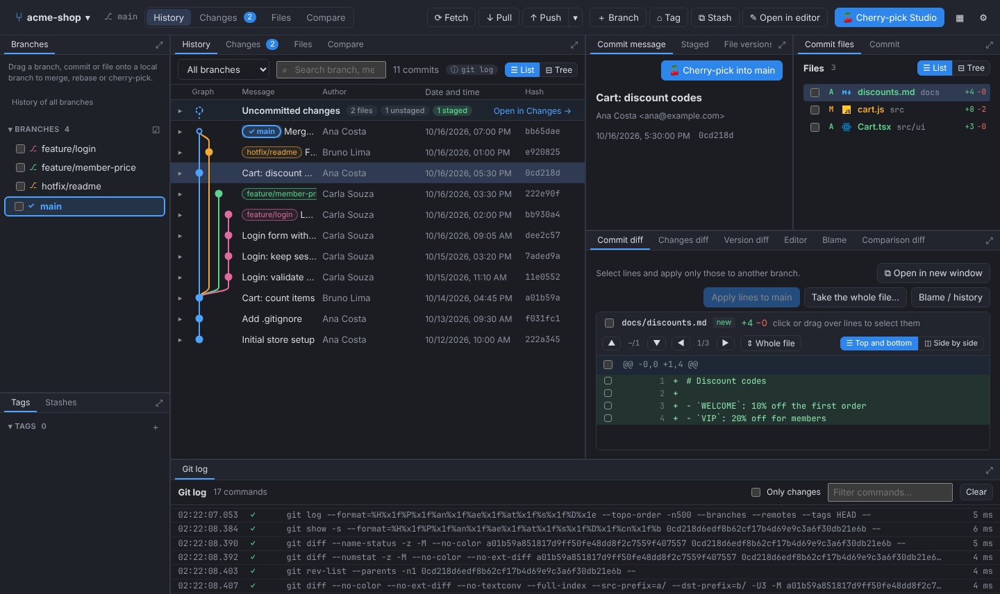
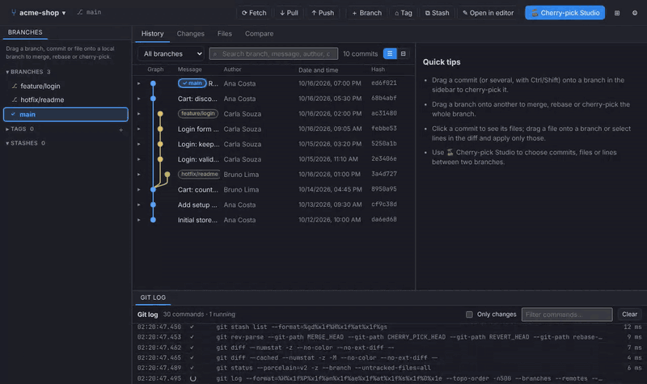
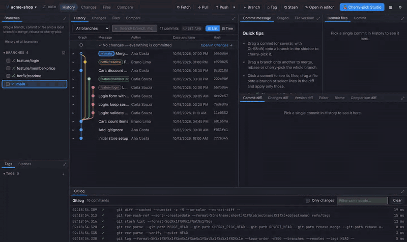
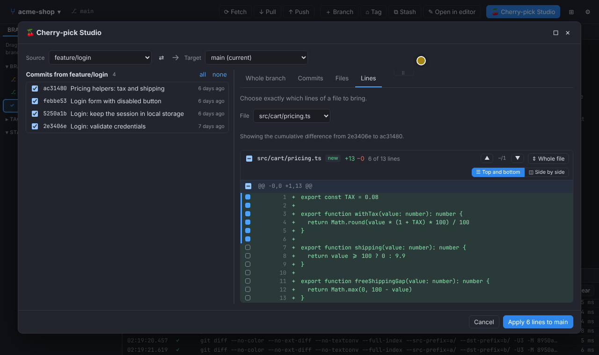
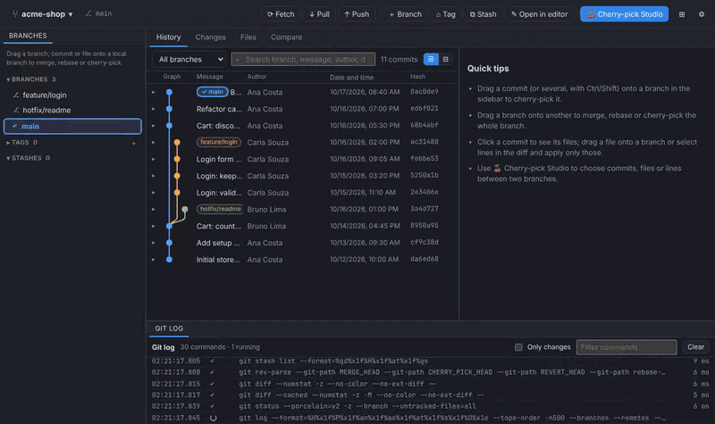
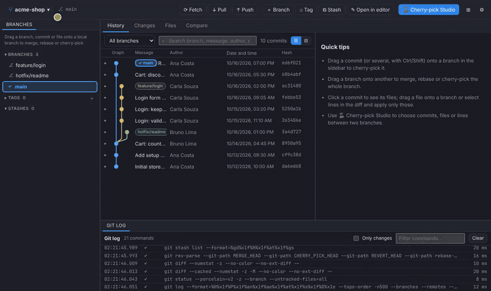
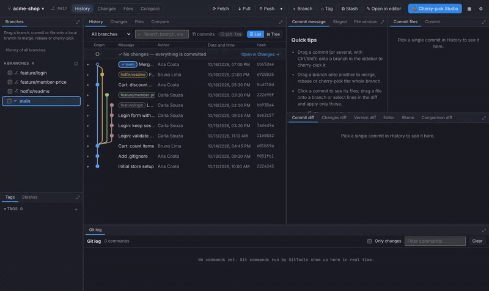
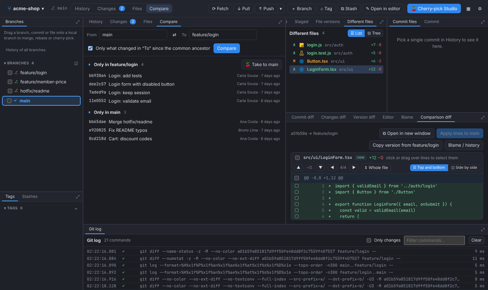
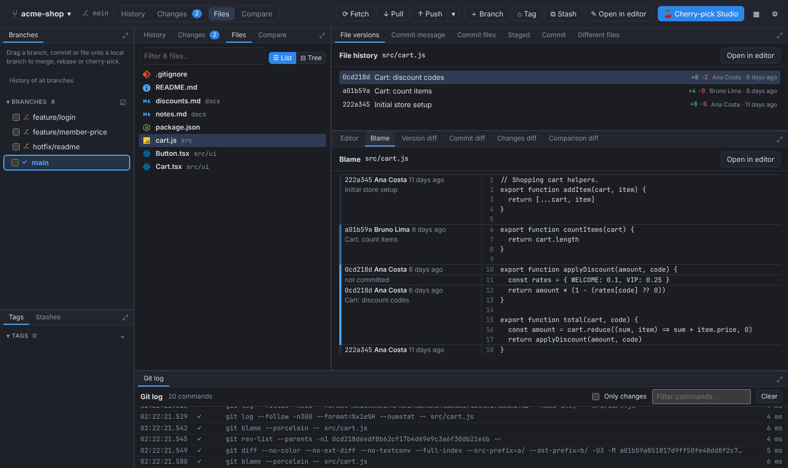

  

<h1 align="center">GitTools</h1>

  <b>Git with a visual interface inside VS Code.</b> 
  Drag and click to merge, rebase and cherry-pick whole branches, single commits, files — or even <i>individual lines</i>.

  
  
  

GitTools turns the git commands that are hard to remember — especially **cherry-pick** — into things you can
simply **drag and drop**. It runs on the git that is already installed on your machine, needs no account and
sends nothing anywhere.

## Why GitTools?

> **Tired of one tool for the graph, another for conflicts, and yet another to pick what goes into a commit?**
> GitTools brings together the best of what the top Git tools on the market do — in a single, lightweight,
> free interface that lives right inside VS Code.

- 🌳 **A beautiful history graph** like the best visual clients: colored lanes, search, tags and columns you can rearrange.
- ✅ **Pick your commit with checkboxes**, or drag files between *staged* and *unstaged* — choose the view you like, in the same screen.
- ✂️ **Line-by-line staging**: commit only the lines that matter, straight from the diff.
- 🔀 **Side-by-side conflict editor** (*current × result × incoming*), block by block, no terminal needed.
- 🍒 **Cherry-pick on another level**: a whole branch, commits, **files** or **lines** — just drag.
- 🧹 **Visual interactive rebase**, **blame**, file history and branch comparison — one click away.
- 🧩 **A workspace your way**: move panels and tabs wherever you want, like in a modern editor.
- 🔒 **No account, no cloud, no telemetry.** It uses the git you already have installed. Open source (MIT).

*One tool. The whole Git workflow. No more switching windows.*

## Highlights

- 🍒 **Cherry-pick anything**: a whole branch, chosen commits, specific files, or just the lines you select.
- 🖱️ **Drag & drop**: drop a branch, commits or files onto another branch and pick what to do.
- 🔀 **Side-by-side conflict editor**: *current × result × incoming*, block by block.
- 🌳 **History graph** with colored branch lanes, search, tags and resizable columns.
- 🧭 **Better diffs**: line selection, whole-file view, side-by-side mode, `F7`/`F8` to jump between changes and files.
- 📁 **File list or folder tree** everywhere, with `+added −removed` line counts.
- 🎨 **Looks native**: follows your VS Code theme, fonts and the same colors VS Code uses for modified, added and deleted files, with file-type icons (can be turned off in Settings → Appearance).
- 🧩 **Arrange the workspace your way**: every panel is independent — drag any panel to any side of any other panel.
- ☑️ **Focus on a few branches**: tick the checkboxes in the branch sidebar and the history shows only those branches.
- 📜 **Live git log**: see every command GitTools runs, in real time.
- 🌍 **6 languages** (English, Português, Español, 中文, हिन्दी, العربية) and a theme that follows VS Code.

---

## Cherry-pick a whole branch

Drag a branch from the sidebar onto another one and choose **Merge**, **Rebase** or **Cherry-pick every commit**.
Commits that were already applied are skipped automatically.

## Cherry-pick only some **lines**

Open a commit, click or drag over the lines you want and hit **Apply lines to…**. GitTools builds a partial patch
with just those lines and applies it with `git apply --3way` — keep it staged for review, or commit it right away.

## Cherry-pick Studio

One place to pick **commits, files or lines** between any two branches: *Whole branch*, *Commits*, *Files* and *Lines* tabs.

## Resolve conflicts side by side

When a cherry-pick, merge or rebase conflicts, open the conflict editor: choose *current*, *incoming* or *both* per block
(or for the whole file), edit the result, and continue — all without leaving the panel.

## Folder tree and diff navigation

Switch every file list between **List** (file name + folder) and **Tree**. In any diff, `F7` / `Shift+F7` jump to the
next / previous change and `F8` / `Shift+F8` to the next / previous file.

## Arrange the workspace

No panel is a "parent" of another: the commit list, the commit message, the commit's files and diff, the *Unstaged* and
*Staged* lists, the commit box, the changes diff, the file browser, blame, the comparison and the Git log are all
independent panels. Drag a panel's tab onto the middle of another panel to make it a tab there, next to one of its
edges to split that panel on that side, or onto the window edge — any panel, anywhere. The **History / Changes /
Files / Compare** buttons bring a screen's panels to the front wherever you left them, **▦** shows or hides any
panel, and *Restore default layout* puts everything back.

## Compare, blame and file history

Compare any two branches, tags or commits and bring over lines or whole files; see who changed every line with
**Blame**; follow a file through renames in its **history**.

| Compare | Blame |
| --- | --- |
|  |  |

---

## Getting started

1. Open a folder that is a git repository (or use **GitTools: Open a repository…**).
2. Run **GitTools: Open GitTools** — `Ctrl+Alt+G` (`⌘⌥G` on macOS) — or click **⑂ GitTools** in the status bar.

| Command | What it does |
| --- | --- |
| **GitTools: Open GitTools** | Opens (or reveals) the GitTools panel. |
| **GitTools: Open a repository…** | Picks another repository folder. |
| **Open this folder in GitTools** | Explorer context menu on a folder. |
| **Show this file's changes in GitTools** | Opens the diff of the current file in a panel beside it (editor title button). |

Right-click a commit in the history for **Copy message ▸** (full message, title only or description only).

Files that GitTools opens (*Open in editor*, file menus, conflict files) open in **VS Code's own editor**, beside the panel;
*Open in editor* on the project reveals it in VS Code's Explorer (or opens it in a new window if it isn't the open folder).

## Keyboard shortcuts (inside the panel)

| Action | Shortcut |
| --- | --- |
| History / Changes / Files / Compare | `Ctrl+1` … `Ctrl+4` |
| Search the history | `Ctrl+F` |
| Cherry-pick Studio | `Ctrl+Shift+P` |
| Next / previous change in a diff | `F7` / `Shift+F7` |
| Next / previous file in the list | `F8` / `Shift+F8` |
| Fetch / Pull / Push | `Ctrl+Shift+F` / `Ctrl+Shift+L` / `Ctrl+Shift+K` |
| Force push (with lease) | `Ctrl+Alt+Shift+K` |
| All shortcuts | `F1` |

Every shortcut can be changed in **⚙ Settings → Keyboard shortcuts**.

## Settings

Open **⚙** in the panel's top bar: language, theme, file icons and change letters (M, A, D…), diff layout and whether
diffs show only the changed parts or the whole file, notification position and size, your git identity
(`user.name` / `user.email`, global or per repository) and **remotes** (add, rename, change URL, remove).

## Requirements

- [Git](https://git-scm.com/) 2.23 or newer on your `PATH`.
- VS Code 1.90 or newer.

## Privacy

Everything runs locally. GitTools only runs `git` commands on your machine; it has no telemetry, no account and no
network calls of its own (git itself talks to your remotes when you fetch, pull, push or clone).

## Links

- 💻 Source code & issues: <https://github.com/DaniloFG/GitTools>
- 🖥️ Also available as a standalone desktop app (Windows, macOS, Linux) from the same repository.

Released under the [MIT License](https://github.com/DaniloFG/GitTools/blob/main/LICENSE).

## Credits

File-type icons are a subset of an open-source icon set (MIT) — credits and license in `THIRD_PARTY_NOTICES.md`.
